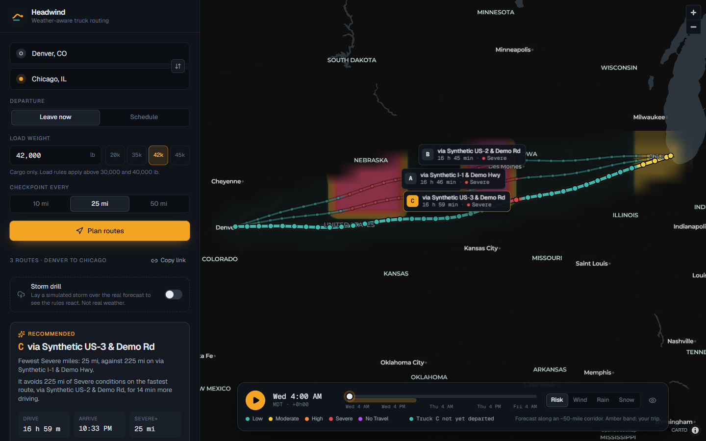
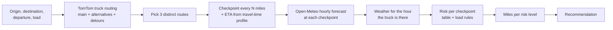

# Headwind · weather-aware truck routing

Headwind helps a truck driver pick the safest route. It compares three truck routes against the forecast **for the hour the truck reaches each stretch of road**, scores the risk with the assignment's rules and load limits, and recommends a route with a plain-language reason.

- **Live app:** _add the Vercel URL here after deploying_
- **Walkthrough (Loom):** _add the link here_



<sub>Screenshot from the end-to-end test fixtures: synthetic routes and a scripted storm, so every risk level shows. Live use draws real TomTom truck routes and the real Open-Meteo forecast.</sub>

## What it does

- **Three truck routes.** TomTom's truck routing, given the load plus a typical tractor-trailer's weight and 53 ft trailer dimensions, so weight limits and low bridges are respected.
- **Checkpoints every 10, 25 or 50 miles,** each with an ETA from TomTom's own travel-time profile along the route, in the local time zone of that checkpoint.
- **Weather at each checkpoint's ETA** from Open-Meteo's hourly forecast.
- **Risk per checkpoint** from the rules table and load rules, with the reason spelled out ("Wind 38.2 mph with a 42,000 lb load (over 40,000 lb) is Severe.").
- **A recommendation** that names the deciding rule and what it costs ("It avoids 225 mi of Severe conditions on the fastest route, for 14 min more driving.").
- **A map** with routes coloured by risk along their length, clickable checkpoints, and route summaries pinned to the map.
- **A 0–48 hour heatmap** of risk, wind, rain or snow along the trip corridor, with a slider and play button.

## How a route is scored



1. **Routes.** One TomTom request asks for the main route plus alternatives. Two more requests force detours through via-points on either side of the trip, because providers often return alternatives that share most of their road. Routes are de-duplicated by geometric overlap: a candidate sharing more than 85% of its length within 1 km of a chosen route is skipped, and anything over 1.6× the fastest drive time is ignored.
2. **Checkpoints.** One at the start, one every interval, and one at the destination, measured by great-circle distance along the full-resolution route.
3. **ETAs.** TomTom reports travel time at points along the route, reflecting speed limits and typical traffic for the departure time. ETAs are interpolated between those points, not spread at an average speed.
4. **Weather at the ETA.** Open-Meteo's rain, showers and snowfall are totals for the hour *before* each timestamp, so a truck passing at 14:20 gets the 15:00 values, which cover 14:00–15:00. Wind is an instant reading and is interpolated between 14:00 and 15:00. Rain is rain plus showers. Total precipitation isn't used because it already includes snow and would count it twice. Everything is fetched in metric and converted in one tested module.
5. **Risk** is the worst of the wind, rain and snow levels, raised by the load rules.
6. **Miles per level.** Each checkpoint covers the road halfway to its neighbours.

### Risk rules and how the table's edges are read

| Condition | Low | Moderate | High | Severe | No Travel |
|---|---|---|---|---|---|
| Wind (mph) | < 25 | 25 to < 35 | 35 to < 45 | 45 to < 55 | ≥ 55 |
| Rain (in/hr) | < 0.10 | 0.10 to < 0.25 | 0.25 to < 0.50 | 0.50 to 1.00 | > 1.00 |
| Snow (in/hr) | < 0.5 | 0.5 to < 1.0 | 1.0 to < 2.0 | 2.0 to 3.0 | > 3.0 |

- **Overlapping edges.** The brief's table shares edges between bands, for example 0.25 in/hr appears in both Moderate and High. Here each band includes its lower edge, so 0.25 in/hr is High and 35 mph is High.
- **No Travel edges.** No Travel for rain and snow is written as strictly greater than, so exactly 1.00 in/hr of rain and 3.0 in/hr of snow are Severe.
- **Load rules:** ≥ 55 mph is No Travel for any load. 45–54 mph with **more than** 30,000 lb is No Travel. 35–44 mph with **more than** 40,000 lb is Severe. Exactly 30,000 or 40,000 lb doesn't trigger.
- **Load weight is cargo.** The load rules use the weight the driver enters. Routing restrictions need gross weight, so TomTom gets load + 35,000 lb (a typical empty tractor and trailer). Above 80,000 lb gross the app warns that a permit is needed.

The heatmap uses a continuous version of the same scale (band number plus position within the band). A property test checks that it never disagrees with a checkpoint's level.

### Recommendation order

1. Fewest **No Travel** miles
2. Fewest **Severe** miles
3. Fewest **High** miles
4. Lowest **average risk**, distance-weighted, Low = 0 to No Travel = 4
5. Shortest **travel time**

The brief starts at Severe. No Travel is compared first because a route through No Travel conditions can't be safer than one through Severe. Miles are compared to 0.1 mile so rounding noise can't decide. If every route crosses No Travel conditions, the app says so plainly. Checkpoints beyond the forecast are reported as "beyond forecast" and are never silently scored as safe.

## The heatmap

The backend lays a grid over the corridor, about 50 miles either side of the three routes, at roughly 240 cells. It fetches 48 hours of weather for those cells in one batch and packs four variables into bytes: risk, wind, rain and snow. The grid is regular in Web Mercator, the map's projection, so each cell is exactly one pixel of the texture the GPU stretches over the map. A latitude/longitude grid would drift against the roads on long north–south trips.

The browser draws it with a small **WebGL2 layer**. All 49 hourly frames are uploaded once. For each pixel the shader interpolates between nearby cells, ignoring cells outside the corridor, and between the two hours either side of the slider. It then looks the value up in a colour table. Moving the slider changes two numbers on the GPU: no network calls, no React re-renders, no texture uploads. Calm weather is transparent, so the map stays readable.

## Beyond the brief

- **Best time to leave.** The assessment also re-scores every route for departures every 2 hours over the next day, from the same weather fetch. It suggests the safest, earliest-arriving time, with one click to re-plan. Departures that would run past the forecast are never treated as safer.
- **Storm drill.** An opt-in, clearly labelled simulated storm is laid over the real forecast (the larger value wins). It shows the rules, the reroute and the departure-window logic working on a calm day. The map, recommendation and URL all say it's simulated.
- **Ghost trucks.** As the forecast plays, a marker shows where each route's truck would be at that hour, coloured by the risk on that stretch.
- **Shareable links.** The trip lives in the URL, and **Copy link** opens the same plan.
- **Drop a pin.** Click empty map to name the spot (TomTom reverse geocoding) and use it as the start or end.
- **Phone layout.** A full-screen map under a draggable bottom sheet with three snap points. The forecast dock rides on the sheet, and the camera keeps routes framed in the visible map.
- **Resilience.** The page wakes the API on load and explains a slow cold start kindly. If the basemap host is unreachable, routes and the recommendation still work and the map says why it's missing. Provider rate limits show a clear message and retry.

## Architecture

```
backend/                Django 5.2 + Django REST Framework, no database (stateless API)
  core/                 pure logic, no I/O: risk, units, geo, eta, weather_align,
                        mileage, ranking, route_select, heatmap_grid, storm
  providers/            TomTom (routing, search), Open-Meteo, shared HTTP retries,
                        dev-only fake routing
  trips/                serializers, views, services (the glue)
  tests/                pytest + hypothesis + respx
  scripts/              make_e2e_fixtures.py
frontend/               React 19 + Vite 8 + TypeScript (strict)
  src/features/         trip-form, routes, map, heatmap, timeline, layout
  src/lib/              typed API client (generated from OpenAPI), geo, risk, format, queries
  e2e/                  Playwright tests against the production build with fixtures
docs/openapi.yaml       API schema; CI fails if it drifts from the code
vercel.json             one Vercel project, two services: the React app at /, Django at /api
```

| Endpoint | Purpose |
|---|---|
| `GET /api/geocode?q=` | Place autocomplete (TomTom, US and Canada) |
| `GET /api/reverse?lat=&lon=` | Name a point picked on the map |
| `POST /api/routes` | Three routes with checkpoints and ETAs |
| `POST /api/assess` | Weather and risk per checkpoint, recommendation, departure window |
| `POST /api/heatmap` | 49 hourly frames of corridor weather |
| `GET /api/rules` | The rules table as data |
| `GET /api/schema` | OpenAPI schema |

The endpoints are stateless, so any serverless instance can answer any request, and the map can draw routes before the weather is in. Libraries were chosen over hand-rolled code wherever a good one exists:

- **Map:** MapLibre GL.
- **UI parts:** Radix, cmdk and Sonner.
- **Data:** TanStack Query and Zustand.
- **Motion:** GSAP and ScrollTrigger, Lenis, Motion and NumberFlow.
- **Geometry:** shapely and pyproj.
- **Time zones:** timezonefinder.

The heatmap layer and the risk engine are custom because nothing suitable exists.

## Running locally

Requirements: Python 3.12+ with [uv](https://docs.astral.sh/uv/), Node 22+ with pnpm, and a free [TomTom API key](https://developer.tomtom.com) (no card needed). Open-Meteo needs no key.

```bash
cp .env.example .env            # add TOMTOM_API_KEY
cd backend && uv sync && uv run python manage.py runserver 8000
cd frontend && pnpm install && pnpm dev   # http://localhost:5173 (proxies /api to :8000)
```

No TomTom key yet? Start the backend with `FAKE_ROUTING=1 DJANGO_DEBUG=1` to use synthetic routes with real weather. This is honoured only in debug mode and never in production.

## Tests

```bash
cd backend && uv run pytest && uv run ruff check . && uv run mypy
cd frontend && pnpm test && pnpm typecheck && pnpm lint && pnpm e2e
```

- **Backend (pytest):**
  - **Risk rules:** every band edge and load rule, plus property tests (more wind, rain, snow or load never lowers risk).
  - **ETAs and weather:** ETA interpolation and the hour-bucket weather alignment.
  - **Ranking:** miles per level, the ranking and its explanations, and the departure window.
  - **Storm drill:** the overlay logic.
  - **Providers and API:** provider parsing against recorded response shapes, and the full API with providers faked.
- **Frontend (Vitest):**
  - **Map geometry:** Mercator progress conversion and label collision avoidance.
  - **Heatmap:** decoding and the colour table.
  - **Route gradients:** the draw-on and risk-colour expressions.
  - **Utilities:** time-zone formatting and shareable-link parsing.
- **End to end (Playwright):** runs the production build with deterministic fixtures. Regenerate them with `uv run python scripts/make_e2e_fixtures.py ../frontend/e2e/fixtures`.

CI (GitHub Actions) runs all of it, plus a check that the committed OpenAPI schema matches the code.

## Deploying to Vercel

The repo deploys as **one Vercel project** using [Vercel Services](https://vercel.com/docs/services) (`vercel.json`). The React app is served from the CDN at `/` and Django runs as a Python function at `/api`. Set these environment variables in the project:

| Variable | |
|---|---|
| `TOMTOM_API_KEY` | required |
| `DJANGO_SECRET_KEY` | required, any long random string |
| `REDIS_URL` | optional, a shared cache across function instances |
| `OPEN_METEO_API_KEY` | optional, for a paid Open-Meteo plan |

```bash
npx vercel login
npx vercel --prod
```

## Assumptions and limitations

- **No rest breaks.** ETAs are drive time only and don't model US hours-of-service rest breaks (a deliberate scope choice). A trip longer than about 11 hours of driving would really take longer.
- **Forecast range.** Departures are limited to the next 7 days. Forecast quality falls with lead time, and anything past Open-Meteo's range is flagged rather than scored.
- **Departure window traffic.** The departure window shifts the planned routes in time. It doesn't re-request traffic-aware routing for each start time, but choosing a suggested time does re-plan properly.
- **Shared weather quota.** Open-Meteo's free tier limits requests per IP address, and serverless platforms share outbound IPs. Responses are cached by location and hour, fetched in batches, and retried with backoff. A rate limit shows a clear message. `REDIS_URL` shares the cache across instances.
- **Model resolution.** Weather is taken at the model grid point nearest each checkpoint, about 3 km in the US. Very local effects such as a single mountain pass can be smoothed.

## Credits

Routing and geocoding © TomTom. Weather data by [Open-Meteo](https://open-meteo.com) (CC BY 4.0). Basemap © [CARTO](https://carto.com), map data © [OpenStreetMap](https://www.openstreetmap.org/copyright) contributors.
